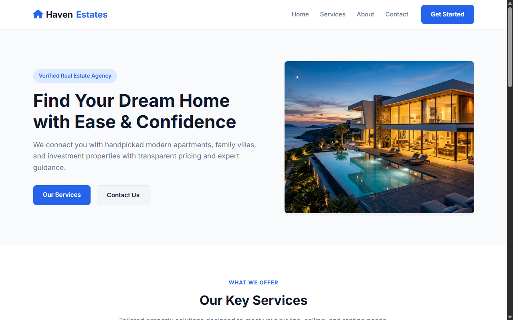
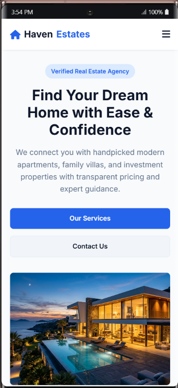
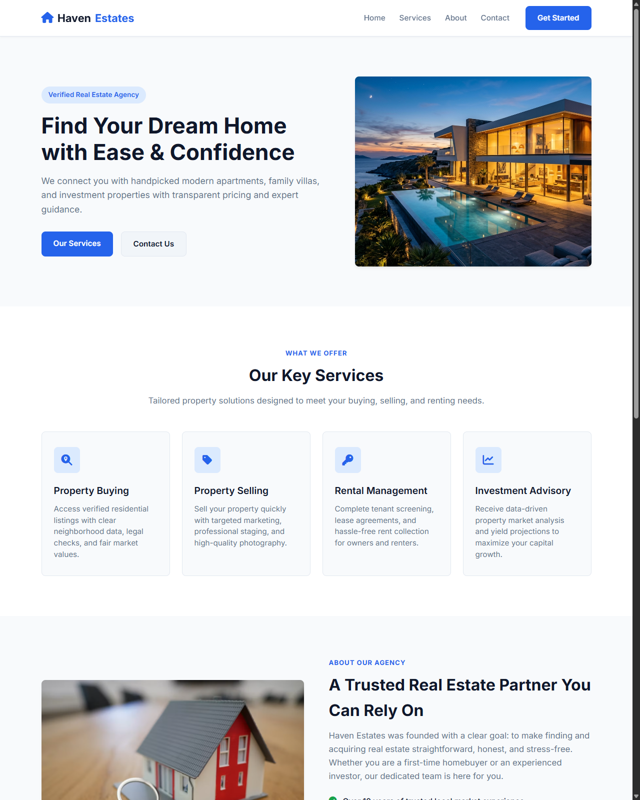

## 1. Project Title

**Haven Real Estate Landing Page** (Business Landing Page)

---

## 2. Objective

The primary objective of this project is to create an aesthetically pleasing, responsive, and trustworthy landing page for a modern real estate business. Key objectives include:

- **Build Brand Credibility**: Present the agency's value proposition, verified listings, and over a decade of local market expertise.
- **Showcase Core Services**: Clearly display key offerings—property buying, property selling, rental management, and investment advisory—using clean, scannable cards.
- **Optimize User Experience**: Ensure seamless navigation and legibility across all device screen sizes (desktops, laptops, tablets, and smartphones) using fluid responsive layouts.
- **Drive Inquiries & Lead Generation**: Provide visitors with direct contact information and an interactive, validated inquiry form to capture prospective customer leads.

---

## 3. Tech Stack

| Technology | Purpose |
| :--- | :--- |
| **HTML5** | Semantic structure (`<header>`, `<nav>`, `<main>`, `<section>`, `<footer>`, `<form>`) and accessible metadata. |
| **CSS3** | Vanilla CSS styling featuring CSS Variables (Design Tokens), Flexbox, CSS Grid, smooth transitions, and responsive media queries. |
| **Vanilla JavaScript (ES6+)** | Lightweight client-side DOM manipulation for the mobile navigation drawer and interactive form validation. |
| **Google Fonts (Inter)** | Clean, modern sans-serif typography with multiple weights (400, 500, 600, 700). |
| **Font Awesome 6.4.0** | Vector icon set for navigation, service categories, contact cards, and social media handles. |

---

## 4. Features Implemented

- **Sticky Navigation Bar**:
  - Distinct company branding with home iconography (`HavenEstates`).
  - Smooth anchor link navigation to page sections (`Home`, `Services`, `About`, `Contact`).
  - Mobile hamburger toggle menu with clean expand/collapse behavior.
  - Prominent "Get Started" call-to-action button.

- **Engaging Hero Section**:
  - High-impact headline and value-focused copy.
  - "Verified Real Estate Agency" credential badge.
  - Dual action buttons: "Our Services" and "Contact Us".
  - Featured modern villa image container with subtle drop shadow and rounded corners.

- **Key Services Grid (4 Core Services)**:
  - **Property Buying**: Verified listings, neighborhood data, legal clarity, and fair market values.
  - **Property Selling**: Rapid property turnaround, targeted marketing, and professional staging.
  - **Rental Management**: Thorough tenant screening, lease agreements, and rent collection.
  - **Investment Advisory**: Market analysis and yield projections for high capital growth.
  - Interactive hover micro-animations (card elevation and border highlights).

- **About Us Section**:
  - 2-column layout highlighting over 10 years of trusted industry experience.
  - Trust checkmarks for verified legal documentation and transparent fee structures.
  - Direct appointment booking trigger.

- **Contact & Inquiry Section**:
  - **Office Information Card**: Physical address (Pune, Maharashtra), direct phone number, email, and operating hours.
  - **Interactive Contact Form**: Inputs for Full Name, Email Address, Phone Number, and Message with HTML5 & JS validation.
  - Dynamic visual status feedback with automatic timeout upon submission.

- **Dark Theme Footer**:
  - Matching company logo, summary tagline, quick links, and social links (Facebook, Instagram).
  - Clean copyright notice.

- **Responsive & Accessible Design**:
  - Mobile-first adaptive layout optimized for screens under 768px.
  - Accessible ARIA labels on navigation buttons and social links.
  - High contrast ratios and smooth scrolling behavior (`scroll-behavior: smooth`).

---

## 5. Folder Structure

```text
Business_Landing_pages/
│
├── asset/
│   └── images/
│       └── hero_image.jpg           # High-resolution hero section image
│
├── css/
│   └── styles.css                   # Main responsive stylesheet & design tokens
│
├── screenshots/
│   ├── 1_desktop_hero_view.png      # Desktop hero and navigation preview
│   ├── 2_mobile_hero_view.png       # Mobile view with hamburger menu
│   └── 3_services_section_view.png  # Services grid section preview
│
├── index.html                       # Semantic HTML5 document & inline JavaScript
└── README.md                        # Project documentation
```

---

## 6. Setup or Run Instructions

No build tools, bundlers, or package installations are required. This project runs directly in any modern web browser.

### Option 1: Direct File Launch
1. Download or clone this repository to your local machine.
2. Locate and double-click `index.html` (or right-click and choose **Open with** > **Google Chrome** / **Firefox** / **Microsoft Edge** / **Safari**).

### Option 2: Using VS Code Live Server
1. Open the project folder in **Visual Studio Code**.
2. Install the **Live Server** extension (by Ritwick Dey) if not already installed.
3. Right-click `index.html` and select **Open with Live Server** (default port `http://127.0.0.1:5500`).

### Option 3: Using a Local HTTP Server (Terminal)

#### Using Python:
```bash
# Navigate to the project directory
cd Business_Landing_pages

# Start Python 3 HTTP server
python -m http.server 3000
```
Open your browser and navigate to `http://localhost:3000`.

#### Using Node.js (`npx serve`):
```bash
# Navigate to the project directory
cd Business_Landing_pages

# Launch static server
npx serve .
```

---

## 7. Live Project Link

- **Live Demo**: [https://sanketsatras.github.io/Business_Landing_pages/](https://sanketsatras.github.io/Business_Landing_pages/)
- **Source Code Repository**: [https://github.com/SanketSatras/Business_Landing_pages](https://github.com/SanketSatras/Business_Landing_pages)

*(Note: Replace with your deployed hosting link on GitHub Pages, Netlify, or Vercel as applicable)*

---

## 8. Screenshots

### Desktop Hero View


### Mobile Responsive View


### Services Section View


---

## 9. Author Details

- **Author**: Sanket Satras
- **Location**: Pune, Maharashtra, India
- **Email**: [Sanketsatras5055@gmail.com](mailto:Sanketsatras5055@gmail.com)
- **Phone**: [+91 8468817421](tel:+918468817421)
- **GitHub**: [https://github.com/SanketSatras](https://github.com/SanketSatras)
- **LinkedIn**: [https://linkedin.com/in/sanket-satras](https://linkedin.com/in/sanket-satras)
